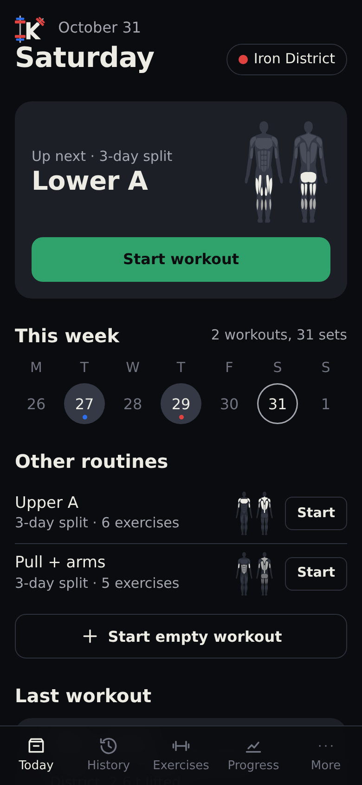
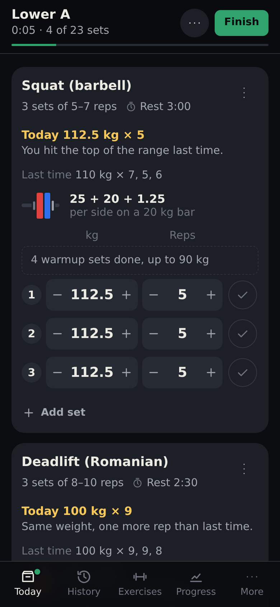
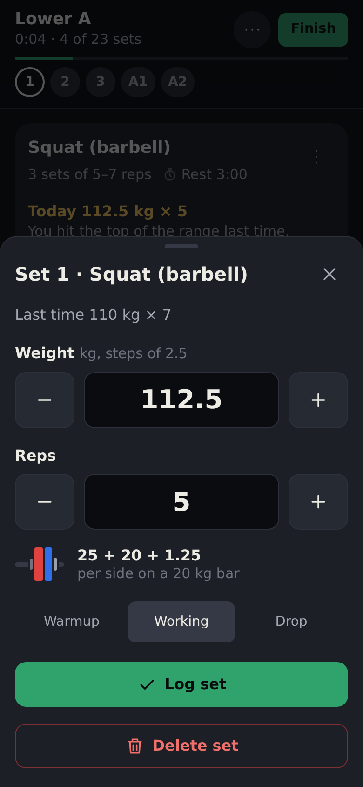
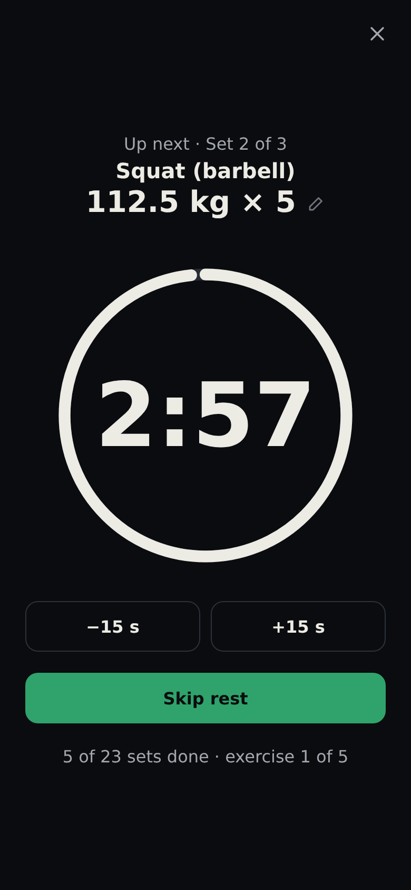
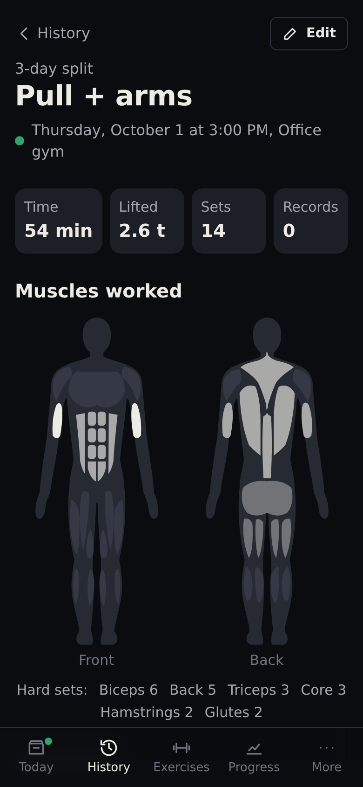
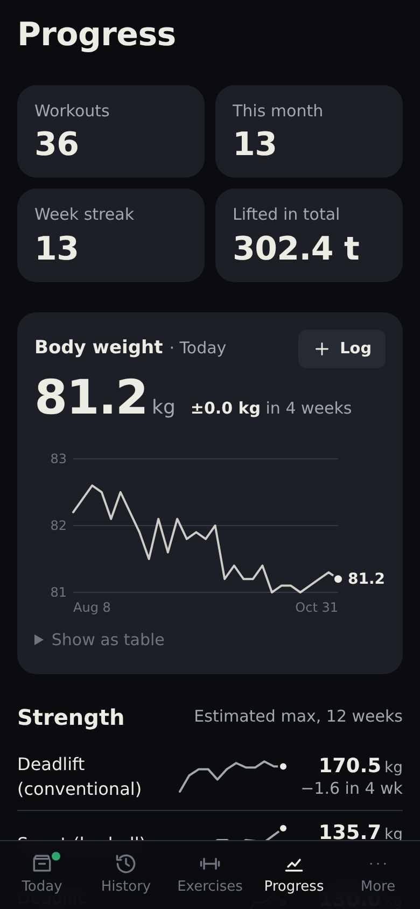

# Kratos

**Use it at [kratos-orpin.vercel.app](https://kratos-orpin.vercel.app/)**: open it on your phone and add it to
your home screen.

A workout tracker for your phone. Plan routines, log sets in a tap or two, rest with a countdown that tells you
what's next, and see your progress, even when you train at more than one gym.

<p>
  
  
  
  
  
  
</p>

<sub>Screenshots use the sample data.</sub>

## Getting started

Kratos is a web app you install from the browser: open it in Chrome on Android or Safari on iPhone, then choose
**Add to Home screen** (Chrome may offer **Install app**). It then opens full screen like any other app and works
offline.

Everything is stored on your phone. A workout in progress, including its rest timer, survives closing the app.
To look around first, open **More → Load sample data**: it fills the app with made-up gyms, routines and 12 weeks
of workouts. **More → Erase all data** starts again from scratch.

## Training

**Today** shows the next routine in your rotation (the one after the routine you did last), this week's workouts
and your other routines, each with a small body map of the muscles it trains. Start a routine, or an empty workout
and add exercises as you go.

At the top of a workout you see its name, the time so far, how many sets you've logged and a progress bar. The
**⋯** button starts a rest timer, changes the gym, adds an exercise, renames the workout or discards it.

During a workout each exercise card shows:

- **Today's target**, worked out from last time (see Progression below), and why, e.g. "You hit the top of the
  range last time".
- **Last time**: the sets you did in your previous workout, e.g. "110 kg × 7, 5, 6".
- **Plates per side** for barbell lifts, using the plates your gym has.
- **Your sets**, each with − and + buttons for the weight and the reps, in steps that suit the equipment (the
  smallest plate pair for barbells, 2 kg for dumbbells, the stack step for machines). Tap the tick to log a set.
- **Tap a set's number or weight** to type a value, change the set type (warmup, working, drop) or delete it. Timed
  exercises set their time here too.

The menu on each card adds warmup or drop sets, changes the rest,
links exercises into a superset, and moves or removes the exercise. A finished exercise folds to one line
("Squat 112.5 kg × 5, 5, 4") so the next one moves up; tap it to open it again.

**Finish** saves the workout with your notes. If some sets aren't ticked, it lists them and you choose: log them as
planned, or save without them.

### Rest timer

Logging a set starts the rest, full screen, with the next exercise and its target above the countdown. Tap the
next set to change its weight or reps while you rest. Use −15 s and +15 s to adjust the rest, close it to keep a
small bar at the bottom, or skip it. A line at the bottom shows how far you are through the workout. When an exercise is finished, or
you dismiss the rest, the page scrolls to the next set.

- The rest comes from the exercise in this workout or routine, else the exercise's default, else the app default
  (**More → Default rest**). Warmups rest at most 60 s.
- Beeps at 10 seconds (on rests of 20 s or more), for the last 3 seconds and at zero, plus vibration. Set the
  volume, or turn the beeps or vibration off, in **More**.
- **Pause music during the countdown** (More): on Android, Spotify, Qobuz and other music apps pause for the last
  3 seconds and carry on afterwards.
- **From the lock screen**: on Android the rest shows in the media notification with the next set and the time
  left. Its buttons add or take 15 seconds and skip the rest (play and pause leave it running).

### Set types

- **Warmups** can be planned automatically: a ramp to your first working weight (the empty bar, then about
  40/60/80 % for barbells; 50/75 % for other equipment). Once done they fold away so the working sets stay in
  view.
- **Supersets**: two or more exercises done back to back, with an optional short rest between them and a longer
  rest after each round. The timer takes you through them in turn.
- **Drop sets**: in a routine, straight sets can end with 1–3 drops, each lighter than the set before (20 % by
  default, rounded to the equipment's step). They follow straight on, or after a short rest you choose, and the
  full rest starts after the last drop. Reps start from last time's drops. **Add drop set** on an exercise's menu
  adds one at any time, 20 % lighter.
- **Timed exercises** (planks, wall sits, hangs) log time held instead of reps. The start button counts down from
  the target with beeps for the last 3 seconds, keeps counting past zero, and logs the time when you stop. With no
  target it's a stopwatch.
- **Bodyweight exercises**: the weight is what you add (belt, vest). Empty means bodyweight only, shown as BW;
  10 shows as BW +10 kg.

### Progression

Each exercise in a routine has a target range and a progression rule, and Kratos suggests the next workout from
the last one:

- **Double progression**: add a rep each time until every set reaches the top of the range, then add weight and
  start again at the bottom.
- **Linear**: add weight whenever every set reached the bottom of the range.
- **None**: repeat what you did.

Timed exercises progress 5 seconds at a time.

## Routines and exercises

- **Routines** (More → Routines): exercises in order, with sets and reps or hold times, drop sets, warmups, rest
  and progression. Adding an exercise opens these settings; tap it later to change them. Tap **Superset** between
  two exercises to link them. Routines you no longer use can be archived; their workouts stay in history. A routine can
  be exported on its own to share it.
- **Plans**: name routines "Plan > Day" (e.g. "ULUL 2026 > Upper #1") and they're grouped into a plan. Today suggests
  the next day of the plan you're following, even if you did a routine from outside it in between (mobility,
  rehab). Archive or restore a whole plan at once, or add a day to it. Routines imported from FitNotes are already
  named this way.
- **Exercises**: a built-in library named so related movements sort together (`Curl (dumbbell, incline)`,
  `Leg curl (seated)`, `Row (seated cable)`), plus your own. Each exercise has its history, charts, records (with
  a best-weight-by-reps table) and setup.

## More than one gym

- Each gym has its own bar weight, plates and machine weight step; a machine can also have its own step. Changes to a
  gym save as you make them.
- Machines and cables differ between gyms, so their history, targets and records are kept per gym, with a note
  for each gym (seat position, pin, which machine). Free weights share their history everywhere.
- Give a gym a location (More → gym → Location) and Kratos switches to the gym you're at when a workout starts,
  with an undo. You can turn this off in More.

## History and progress

- **History**: a monthly calendar and every workout, filterable by gym, with its start time, duration and volume. Open a
  workout to see its sets, notes, a body map of the muscles it worked (shaded by hard sets) and the records you set.
- **Fixing a workout**: open it and tap **Edit**. Tap a set to change or delete it, add sets or exercises you
  forgot, remove an exercise, change the name, date and time, length, gym or notes, or delete the whole workout.
  History, records and next targets follow the change.
- **Progress**: your number of workouts, workouts this month, the weeks in a row you've trained and the total
  weight lifted; body weight with its trend; your main lifts' estimated max over 12 weeks, with the change in the
  last 4 (free-weight lifts you train most; tap one for its charts); body measurements (waist, chest, arm, thigh);
  sets per muscle over the last 7 days; and recent records.
- **Records**: the best estimated one-rep max; for bodyweight exercises, the most added weight or the most reps;
  for timed exercises, the longest hold.

Charts show the value under your finger and can be shown as a table.

## Your data

- **Download / Restore backup** (More): the whole database in one file. Restoring replaces everything.
- **Import from file / Export…** (More): move routines, exercises, workouts or body entries between Kratos copies.
  A preview shows what's new; anything you already have is skipped, so importing twice is harmless.
- **Google Drive** (More → Data): keeps a `Kratos data.json` file in your Drive and shares it between devices.
  Kratos can only see the file it created. The app still works offline and syncs after changes, when a workout
  ends, and on **Sync now**. When both sides changed you choose: merge both, use Drive's copy, or keep this
  device's. Google asks for a tap to sign in each time you open the app, and only the Google account you
  connected with can sync: to switch accounts, disconnect and connect again. Drive keeps earlier versions of the
  file for 30 days.
- Kratos saves from one tab or window at a time. If you open it again elsewhere on the same device, the older one
  stops saving and tells you; reload it to carry on there.
- Every file is checked before anything changes, and nothing is sent anywhere except your own Google Drive.

### Coming from FitNotes

`tools/fitnotes_to_kratos.py` turns a FitNotes backup into a Kratos import file. It brings over routines (each
FitNotes day becomes a routine named "Plan > Day", supersets included) and, optionally, every workout and your
body weight. Exercises are matched to the library and to what's already in the app, so nothing is duplicated.
Your FitNotes notes (machine settings) and rest times come along; targets come from your latest workouts.

```sh
python3 tools/fitnotes_to_kratos.py FitNotes_Backup.fitnotes --routine "ULUL 2026" -o ulul.kratos.json
python3 tools/fitnotes_to_kratos.py FitNotes_Backup.fitnotes --all-routines --workouts --body -o all.kratos.json
```

`--routine` can be repeated. `--gym` names the gym the workouts go to (default "My gym"); `--all-exercises` also
brings exercises nothing uses. The script prints how it renamed exercises and the targets it worked out: check
them, then use **More → Import from file**.

## Phone settings

- **Keep screen on** (More) stops the screen dimming while Kratos is open.
- Location, keep screen on, installing and working offline need the app to be opened over HTTPS.

## Contributing

Developer setup, commands and project conventions are in [AGENTS.md](AGENTS.md).

## License

Copyright (C) 2026 Kratos contributors.

Kratos is free software under the GNU Affero General Public License, version 3 or (at your option) any later
version. See [LICENSE](LICENSE). If you run a modified version for others over a network, you must offer them
its source code.
